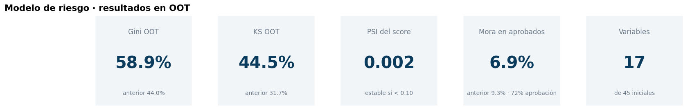
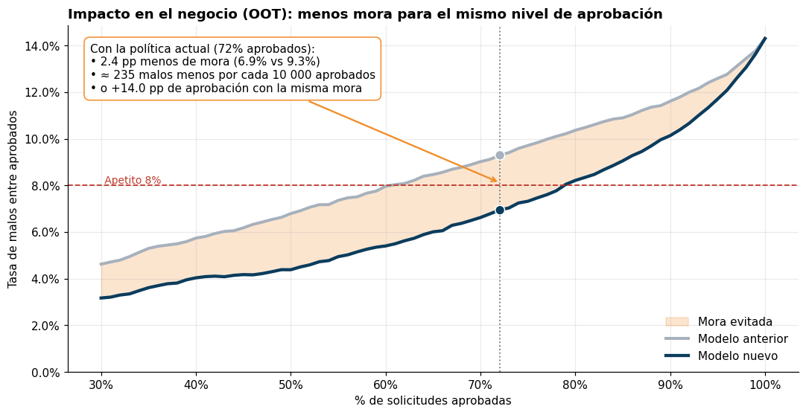
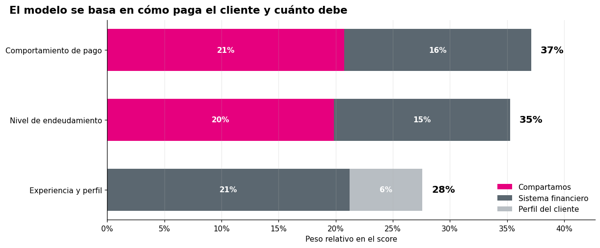

# Renovar a más personas con menos riesgo: credit scoring para Compartamos Banco

> 🥉 **3.er lugar** · Data Analytics Lab · Compartamos Banco Perú · Grupo 10

Modelo de **probabilidad de default (PD)** que predice si un cliente superará **60 días de atraso en los próximos 12 meses**, usado para decidir a quién renovar el crédito sin pasar del **8 % de mora grave** en la cartera aprobada.



## Resultados (muestra fuera de tiempo, OOT: mar–may 2024)

| Métrica | Modelo nuevo | Modelo anterior |
|---|---|---|
| Gini | **58.9 %** (IC 95 %: 57.0 %–60.9 %) | 44.0 % |
| KS | **44.5 %** | 31.7 % |
| Mora entre aprobados (con 72 % de aprobación) | **6.9 %** | 9.3 % |
| PSI del score (DEV vs OOT) | **0.002** (estable) | n. a. |

- **Punto de corte:** PD ≤ 18.5 %, elegido en DEV para que la mora de los aptos no supere el 8 %. En OOT aprueba al **72 %** de los clientes (estable entre 71.8 % y 72.4 % por mes) con una mora de **6.9 %**.
- **Menos mora o más aprobación:** con el mismo 72 % de aprobación, el modelo nuevo reduce la mora en 2.4 puntos porcentuales (unos 235 malos menos por cada 10 000 aprobados). Visto al revés, mantiene la mora del modelo anterior aprobando unos 14 puntos porcentuales más de clientes.
- **Concentración del riesgo:** el 28 % de clientes no aptos concentra el 65 % de los casos de mora grave.
- **Mejora sobre el modelo anterior:** +12.6 a +17.0 puntos de Gini (IC 95 %, bootstrap con 1 000 remuestreos).



## Datos

- **Panel cliente-mes** de 60 000 registros y 49 columnas (`base_analytics_lab_061628.parquet`), observaciones de **jun-2023 a may-2024** (12 meses). No contiene identificadores de cliente.
- **Variable objetivo (`TARGET`):** 1 si el cliente supera 60 días de atraso en los próximos 12 meses (tasa de malos entre 14 % y 17 % según el mes).
- **45 variables explicativas** en 4 familias: perfil sociodemográfico (anonimizado), comportamiento de pago, endeudamiento y transaccionalidad, tanto en Compartamos como en el sistema financiero (SSFF).
- Diccionario completo en [`diccionario_variables_riesgo_credito.csv`](diccionario_variables_riesgo_credito.csv).

**Partición temporal** (sin mezclar meses entre muestras):

| Muestra | Meses | Registros |
|---|---|---|
| TRAIN | 202306 – 202311 | 28 030 |
| VALID | 202312 – 202402 | 15 695 |
| OOT | 202403 – 202405 | 16 275 |

## Metodología

1. **Binning óptimo y WoE** con `optbinning` (monotonía automática, máx. 6 bins, mínimo 5 % por bin).
2. **Diagnóstico de cada variable:** Information Value (IV), estabilidad mensual del IV, CSI entre TRAIN y VALID, y que la dirección del riesgo no se invierta entre meses.
3. **Selección en embudo:** 45 variables → 37 con IV ≥ 0.02 en TRAIN → 32 con IV vigente en los últimos 3 meses ≥ 0.03 → 18 sin redundancia (|corr| ≤ 0.7, revisando VIF) → **17 variables finales** (se retira `MEDIDA2_MORA_SSFF_U36M`, con p = 0.06 y sin pérdida de Gini).
4. **Modelo final: regresión logística sobre WoE**, reentrenada en DEV (TRAIN + VALID). Se comparó contra sin penalización, Lasso y stepwise.
5. **Validación fuera de tiempo (OOT):** Gini con IC por bootstrap, Gini mensual, PSI del score y calibración por deciles.
6. **Política de decisión:** punto de corte según el apetito de riesgo y **semáforo** verde / ámbar / rojo.

### ¿Por qué regresión logística y no XGBoost o LightGBM?

Se compararon árbol, random forest, XGBoost, LightGBM y LightGBM monotónico, con las 17 variables y con las 45 (hiperparámetros por grilla y *early stopping* en VALID).

| Modelo | Gini OOT | Brecha DEV–OOT |
|---|---|---|
| LightGBM (45 vars) | 0.610 | 0.104 |
| XGBoost (45 vars) | 0.610 | 0.142 |
| LightGBM (17 vars) | 0.606 | 0.055 |
| **Logística WoE (17 vars)** | **0.589** | **0.011** |
| Modelo anterior | 0.440 | n. a. |

Los modelos de boosting ganan entre 1 y 3 puntos de Gini, pero con mucha más brecha entre DEV y OOT y menor interpretabilidad. La logística es la que menos se sobreajusta, es la más fácil de explicar a negocio y su PSI es estable, por eso fue la elegida.

### Semáforo de gestión (OOT)

| Grupo | PD | % de clientes | Mora observada | % de los malos |
|---|---|---|---|---|
| 🟢 Verde | ≤ 10 % | 47.8 % | 4.3 % | 14.4 % |
| 🟡 Ámbar | 10 %–19 % | 25.2 % | 12.2 % | 21.6 % |
| 🔴 Rojo | > 19 % | 27.0 % | 34.0 % | 64.1 % |

### Qué mira el modelo

Combina lo que Compartamos sabe del cliente (≈ 41 % del peso del score) con su comportamiento en el sistema financiero (≈ 53 %) y el perfil sociodemográfico (≈ 6 %). La señal más fuerte es el **atraso reciente con Compartamos** (`MEDIDA1_MORA_INTERNA_U6M`).



## Estructura del repositorio

```
├── Compartamos_Final.ipynb                    # Análisis completo, de punta a punta
├── base_analytics_lab_061628.parquet          # Base anonimizada (60 000 × 49)
├── diccionario_variables_riesgo_credito.csv   # Descripción de las variables
├── Modelos_y_Tecnicas_de_Modelamiento_Compartamos_Banco.pdf   # Presentación al jurado
├── graficos/                                  # Figuras generadas por el notebook
├── requirements.txt
└── README.md
```

## Cómo reproducirlo

```bash
git clone <url-del-repo>
cd <nombre-del-repo>
pip install -r requirements.txt
jupyter notebook Compartamos_Final.ipynb
```

El notebook lee el parquet con ruta relativa, así que debe quedar en la misma carpeta. Las semillas están fijadas (`SEED = 42`). La sección *Comparación con otros modelos* entrena varios modelos con búsqueda de hiperparámetros y puede tardar unos 20–25 minutos. El notebook también corre en Google Colab.

## Limitaciones y próximos pasos

- **Calibración:** el modelo sobreestima ligeramente el riesgo en OOT (PD media 15.9 % vs. 14.3 % observado). Conviene recalibrar periódicamente.
- **Punto de corte dinámico:** debe recalcularse con el tiempo para seguir maximizando la aprobación con mora ≤ 8 %.
- **Zona de revisión manual:** los clientes con PD cercana al corte podrían pasar a un analista en lugar de rechazarse de forma automática.
- **Ventana corta:** son 12 meses de observación y 3 de OOT; un periodo más largo permitiría probar la estabilidad ante cambios de ciclo.

## Equipo (Grupo 10)

- Fabricio Joaquin Chavez Ccorahua
- Michel Alexis Bañares Gutierrez
- Cesar Fabrizio Salas Molina

## Stack

Python · pandas · scikit-learn · statsmodels · optbinning · XGBoost · LightGBM · matplotlib
